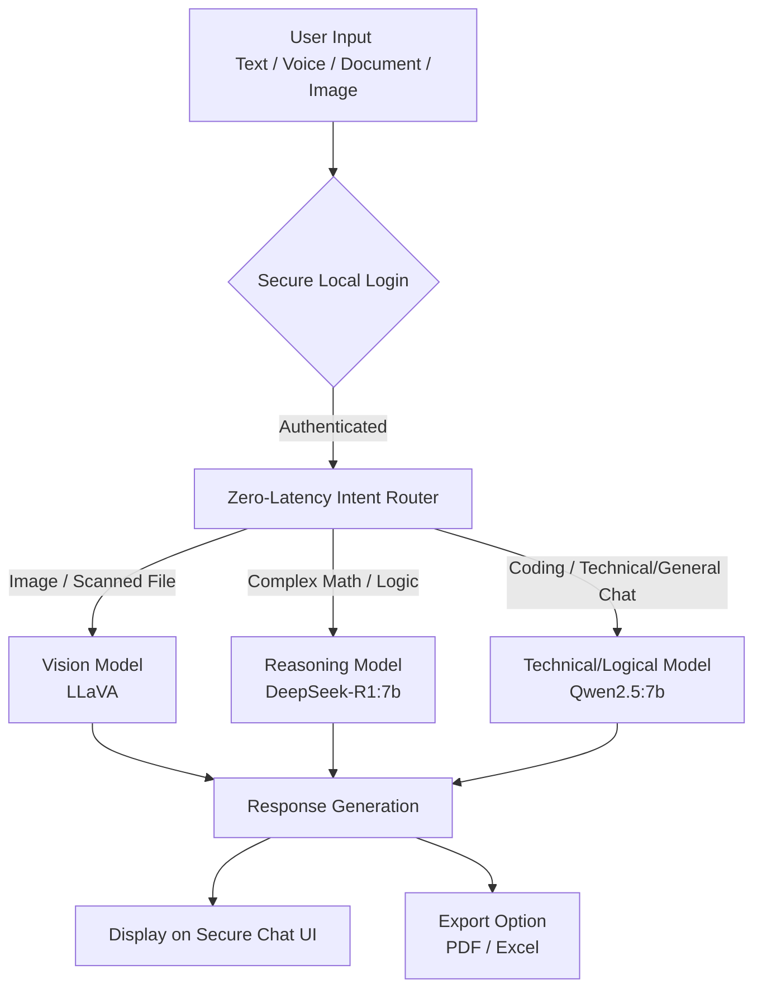

# SOVARA : Sovereign AI Operations & Risk Authority
Industrial Offline Secure AI Assistant 

Welcome to **SOVARA**! 

**The Core Idea (In Simple Words):**
Imagine having a super-smart assistant like ChatGPT, but it lives entirely on your own computer or company server. For many industries (like defense, healthcare, manufacturing, and corporate sectors), data privacy is critical. They cannot upload sensitive documents, trade secrets, or client data to the internet. 

**SOVARA solves this problem.** It is a 100% offline, secure AI chatbot. It can read your private PDFs, understand images, and answer complex questions without ever connecting to the cloud. Your data never leaves your machine. 

To make it incredibly fast and smart, SOVARA uses an "Intelligent Router." Instead of using one giant, slow AI for everything, it quickly analyzes what you are asking and sends your question to the perfect specialized AI model (e.g., a reasoning model for complex math, a vision model for images, or a fast model for general chat).

---

## 🛠️ How It Works (Workflow)

Here is a simple visual flow of how SOVARA processes your requests securely:



## ✨ Key Features
- **100% Offline & Secure:** Zero cloud data egress. All processing is strictly confined to your local workstation/server.
- **Dynamic Model Routing:** Automatically chooses the best AI model for your specific question using a fast router model (`qwen2.5:0.5b`).
- **Zero-Latency Intent Router:** Instant heuristic classifier eliminates the 5-10 second LLM pre-routing delay.
- **Vision Capabilities:** Uses `llava` to read and understand Images (PNG/JPG), scanned PDFs, and visual files.
- **Document Parsing:** Reads PDFs and DOCX files securely using local libraries.
- **Saved Session Management:** Full conversation history by session, with right-click Rename & Delete actions and zero chat loss.
- **Format Export:** Automatically exports LLM output and data tables to Excel (`.xlsx`) or PDF (`.pdf`).
- **Voice Input:** Hands-free operation using Web Speech API integration.
- **Dedicated Authentication:** Secure local login (`/login`) backed by SQLite (`chatbot.db`).
- **Frontend Landing:** Interactive scroll-driven landing page (`sovara_scroll_animation_login.html`).

## ⚙️ Pre-requisites
1. Install [Ollama](https://ollama.com/)
2. Ensure the required models are pulled:
   ```bash
   ollama pull qwen2.5:0.5b
   ollama pull qwen2.5:7b
   ollama pull deepseek-r1:7b
   ollama pull llava
   ```

## 🚀 How to Run
1. Install Python dependencies:
   ```bash
   pip install -r requirements.txt
   ```
2. Start the SOVARA Server:
   ```bash
   python app.py
   ```
   *(Or double-click `start.bat` on Windows)*

3. Open your browser:
   - **Landing Page:** http://localhost:8000/
   - **Login Page:**   http://localhost:8000/login
   - **Chat Room:**    http://localhost:8000/chat

4. Log in using default credentials:
   - **Username:** `admin`
   - **Password:** `admin123`
   *(Or click "Continue as Guest")*
